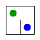

# Assignment 3. Maze Escape

Student ID:251988
Name:Adilzhan Kairgaliev
Group:SE-2540
Maze size (rows x columns):9x12    

This file is the report. Fill it in as you go. How to start: `START_HERE.md`. The task: `docs/Assignment3.pdf`.

## Program output

The 13 lines your program prints on your data (`java -cp out Main`):

    Broken:
    Kept:
    Last broken wall:
    MST cost:
    Heaviest broken wall:
    Path length:
    DFS visited:
    Dead ends:
    Zones:
    Largest zone:
    Is DAG:
    Flow stages:
    Fastest route cost:

My maze:

## Questions

Answer in your own words, two or three sentences each.

Mission 0. What do find and union do, and what makes them fast in your code?
find(x) goes up through the parent links until it reaches the root of the set, and on the way back it points every visited cell straight to the root (path compression). union(a, b) finds the two roots; if
they are equal it returns false, otherwise it hangs the smaller set under the larger one and returns true. Union by size keeps the trees low and path compression makes them almost flat, so both operations are almost constant time.

Mission 1. Why is Broken always R*C - 1, and Kept always (R-1)*(C-1)?
Broken (R×C−1): We have a total of R×C cells (vertices). To connect them all into a single maze with no isolated sections (much like a tree in graph theory), we need exactly one fewer wall than the total number of cells—that is, V−1. Therefore, we always break exactly that many walls.

Kept ((R−1)(C−1)): The total number of internal walls in the grid exceeds what is required for the maze. If we subtract the walls we broke (R×C−1) from the total number of internal walls, we are left with exactly (R−1)(C−1) walls that remain standing in place.

Mission 2. My MST cost from Kruskal and from Prim, and why they are equal:Both approaches gave me the exact same result of 30939. Kruskal sorted all the walls by cost and only knocked down a wall if it connected two different sets using my DSU, while Prim started from cell 0 and used a priority queue to always grab the cheapest wall leading to a new cell. Both algorithms are greedy and rely on the cut property where the cheapest wall crossing any split of cells always belongs to the optimal maze, and since all costs are unique, there is only one unique minimum spanning tree, which is why both algorithms had to find the exact same answer.

Mission 3. Why is there exactly one path between two cells? How did you avoid a stack overflow on a huge maze?
A maze is essentially just a tree: all the cells are connected, and there are exactly R * C - 1 edges, meaning there are no cycles whatsoever. And since there are no cycles, there’s exactly one path between any two cells (otherwise, you’d end up with a loop). To prevent the recursion from crashing—a "stack overflow"—on massive grids like 1000x1000, I implemented the DFS using an array allocated on the heap, rather than relying on the system call stack.

Mission 4. Why does the second pass of Kosaraju go on the reversed graph? Why do the slides have no cycle exactly when Zones equals the number of cells?
If you reverse all the edges, every zone acts like a trap where you can only leave through the incoming paths. Running a double-pass DFS finds these zones one by one in topological order. If there are no cycles, every cell is its own zone so the total count equals n, whereas any cycle traps multiple cells into a single zone making the count less than n, which is why checking for no cycles is equivalent to checking if the number of zones equals n.

Mission 5. Why is it enough to go through the zones in the order of their numbers? What does this pass cost?
After Kosaraju's, the zones are in topological order, so every slide only goes from smaller numbers to larger ones. When we hit a zone, all its incoming paths are already processed, meaning its best cost and longest chain are instantly final. Because of that, a single pass in order is enough—no priority queues needed. It runs in $O(n + m)$ time: we just sort the slides by zone once using counting sort, then look at each zone and slide once.

## AI use

Mission 0:Claude (Anthropic): explained the core concepts of the Disjoint Set Union (DSU) data structure, helped set up the Java and Git environment, and also took part in reviewing my implementation of the `DisjointSet` and `DisjointSetTest` classes.

Mission 1:Claude (Anthropic): helped understand why the number of broken and kept walls follows these formulas, and explained the logic for implementing DSU and wall-breaking.

Mission 2:I used Claude as a reference for drafting the Kruskal and Prim implementations, and to help troubleshoot a rejected git push.

Mission 3:I wrote a non-recursive DFS using an explicit array stack to avoid stack overflows on large grids (like 1000×1000). I just checked with Claude on the syntax/approach for the explicit stack, tested the code on my data, and I can explain how it works.I also used Claude for help with git (a rejected push, merge with the remote)

Mission 4:For Kosaraju's algorithm (two passes with an explicit stack, numbering zones in the second pass order), I handled the implementation while Claude just helped me quickly outline the structure and check why the second pass uses the reversed graph. I tested it on the examples and my data and can fully explain it.I also used Claude for help with git (rejected pushes, merging with the remote)

Mission 5: I implemented the pass over the zones in the order of their numbers to find the longest chain and cheapest route without a priority queue. Claude just helped me quickly verify the logic, I tested it on the three examples and my own data, and I can explain why this order is enough.I also used Claude for help with git (rejected pushes, merging with the remote)
## Timing (Mission 7)

Milliseconds, 5 runs each, from `java -cp out Bench`.

| maze | Kruskal | Prim |
|---|---|---|
| 100 x 100 | | |
| 300 x 300 | | |
| 1000 x 1000 | | |

What do the numbers say about how the time grows? Two or three sentences.

## Complexity

n is the number of cells, m the number of walls (or slides). Fill in every algorithm you wrote.

| algorithm | time | space | assumptions |
|---|---|---|---|
| DSU find and union | | | |
| Kruskal | | | |
| Prim | | | |
| DFS | | | |
| Kosaraju | | | |
| Route in the zone graph | | | |

## Before you submit

- data/walls.txt, data/slides.txt and output/maze.png are in the repository.
- `java tools/Check.java` shows all examples right.
- This README is filled in, the program output and the section AI use included.
- The work is pushed to main (at least one commit per mission) and the repository is public.
- The link is attached in Moodle.
